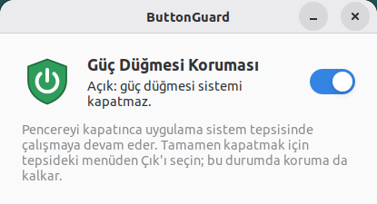

# ButtonGuard

Bilgisayarın güç düğmesine basılınca sistemin kapanmasını engelleyen, tek anahtarlı küçük bir uygulama. Pardus ve Pardus ETAP (etkileşimli tahta) için hazırlanmıştır. İnternet bağlantısı gerektirmez.



## Özellikler

- **Tek anahtar:** Açıkken güç düğmesi sistemi kapatmaz; kapalıyken düğme normal çalışır.
- Anahtarın durumu kaydedilir, yeniden açılışta korunur.
- Her oturum açılışında otomatik olarak arka planda başlar.
- Pencere kapatılınca uygulama sistem tepsisinde çalışmaya devam eder. Tepsi menüsünden pencere açılabilir, koruma açılıp kapatılabilir ve uygulamadan çıkılabilir. Çıkınca koruma da kalkar.
- Kurulumda masaüstü kısayolu eklenir.

## Kurulum

`.deb` dosyasına çift tıkla veya:

```bash
sudo apt install ./buttonguard_<sürüm>_all.deb
```

Gerekenler (Pardus'ta hazır gelir): `python3`, `python3-gi`, `gir1.2-gtk-3.0`. Tepsi simgesi için `gir1.2-ayatanaappindicator3-0.1` önerilir (Pardus ETAP'ta hazır gelir; yoksa GTK tepsi simgesi kullanılır).

Kaldırmak için: `sudo apt remove buttonguard`. Kaldırırken çalışan uygulama kapatılır ve güç düğmesi ayarı eski haline getirilir.

## Nasıl çalışır

Root yetkisi gerektirmez; her kullanıcı kendi oturumu için korumayı açar:

1. **systemd-logind kilidi:** Oturum açık kullanıcı `handle-power-key` için engelleme kilidi alır. polkit bu izni etkin oturuma varsayılan olarak verir.
2. **Masaüstü ayarı:** Cinnamon (ETAP), GNOME, MATE ve XFCE güç düğmesini logind yerine kendileri işler. Bu yüzden masaüstünün güç düğmesi eylemi "hiçbir şey" yapılır. Önceki değer saklanır; koruma kapatılınca, uygulamadan çıkılınca ya da paket kaldırılınca geri yüklenir.

**ETAP / çok kullanıcılı kullanım:** Her kullanıcının anahtarı kendine aittir. Kilit yalnızca o an ekranda etkin olan oturumda geçerlidir. Giriş ekranında (hiç kimse oturum açmamışken) güç düğmesi normal çalışır. Düğmeye uzun süre (yaklaşık 4 sn) basılı tutmak donanım düzeyinde kapatma yapar; bu yazılımla engellenemez.

## Derleme

Python 3 yeterli, Windows'ta da çalışır:

```bash
python build_deb.py
```

Çıktı: `dist/buttonguard_<sürüm>_all.deb`
